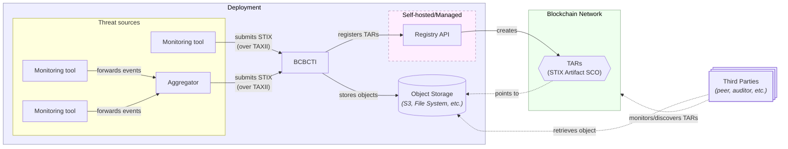
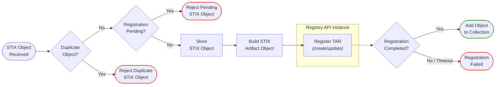
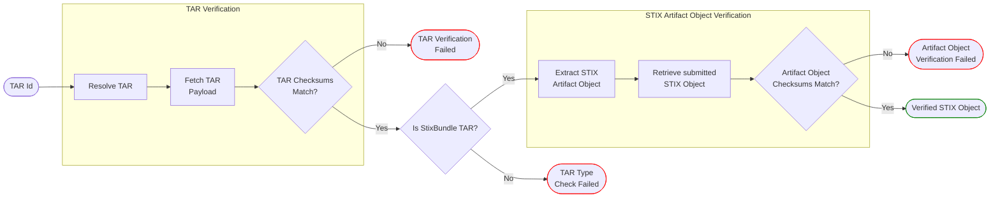

# Architecture

This document describes how the BCBCTI server functions.

## Overview

The BCBCTI server is built around Compellio Gateway's [Registry API](https://docs.compellio.com/registry/) to register a verifiable reference to each STIX Object as a Tokenised Asset Record (TAR). 
The resulting TARs serve as an immutable and verifiable trail, and as a means of discovering threat intelligence signals across systems, while maintaining data confidentiality.

### Ecosystem

Below is a high-level overview of how BCBCTI can be deployed in a monitoring environment:



#### Third Party Access

Through registering STIX Objects as TARs, a deployment provides third parties a way to automatically discover published STIX Artifact Objects, and retrieve the original STIX Objects (based on their access rights to the object storage). 
Those parties can then carry out further analysis, such as correlating data from other similar applications, auditing the Objects, etc.

The way in which access rights are set up depends on the selected storage provider (e.g. cross-account S3 access, pre-shared credentials, etc.) and on the relationship a client has with a third party (e.g. auditor, partner, etc.).

#### Public vs Private Blockchain Networks

Blockchain Networks can either be public (e.g. Ethereum, Polygon, etc.) or private deployments (e.g. private Hyperledger Besu deployment, etc.). The choice of blockchain type depends entirely on the scope of the client's deployment (e.g. public discoverability with public networks, controlled participation with private networks, etc.).

### Tokenised Asset Records (TARs)

TARs are pairs made up of an on-chain smart contract and an off-chain JSON payload.
The smart contract holds versioned checksums of the associated JSON payload, which makes the TAR verifiable from the on-chain data alone.

A TAR Id acts as a unique identifier and a locator to the on-chain smart contract, and, by resolution, its JSON payload.

Read the [Registry API components documentation](https://docs.compellio.com/registry/concepts/components) for more details.

## Data Flow

When new STIX Objects are submitted, the server decides whether to create a new TAR for the object, update the existing TAR associated with the object, or reject it.

This is a high-level overview of how an Object is processed:



Submitted Objects will only appear in their collection once they have been successfully registered by the Registry API.

BCBCTI uses the submitted STIX Object's Identifier to determine whether to create a new TAR, or update an existing one.

A limitation of the current version is that STIX Object modifications will be rejected (_"Reject Pending STIX
Object"_) until the previously submitted version gets registered by the Registry API.

A rejected or failed submission can be resubmitted by the client, but BCBCTI does not retry on the client's behalf.

### STIX Artifact Object

For every submitted STIX Object, BCBCTI creates and registers a new STIX Artifact Cyber-Observable Object (SCO) that points to the original Object's location in the configured storage (e.g. S3, etc.).
It also calculates the SHA-256 checksum based on the canonical representation of the submitted STIX Object (according to the JSON Canonicalization Scheme, [RFC 8785](https://www.rfc-editor.org/info/rfc8785/)).

This ensures submitted STIX Objects remain privately accessible, while allowing their authenticity to be verified. Each submitted STIX Object is mapped to a single STIX Artifact Object, which is registered individually.

### TAR Payload

[//]: # (TODO add TAR Id address)

BCBCTI registers the STIX Artifact Objects it creates under the STIX Bundle TAR Profile (urn:tar:...).
The profile defines a `StixBundle` type to identify the registration as a STIX Bundle.
This lets clients recognise, filter and process the TARs BCBCTI produces.

This is an example payload sent by BCBCTI to the Registry API:

```json
{
    "@context": "urn:tar:...",
    "@type": "StixBundle",
    "version": "2.1",
    "bundle": {
        "type": "bundle",
        "id": "bundle--5a98dfe4-4e5e-4762-8be1-fda03ee3b6c4",
        "objects": [
            {
                "type": "artifact",
                "id": "artifact--f2d12ac8-1b31-5a22-8115-1e74cacde1c0",
                "url": "https://stix.example.com:443/objects/AzPqN9Inkfq5FB4j6Z_ET4UJRUERdzGwNe_9qji9Tio.json",
                "hashes": {
                    "SHA-256": "0333ea37d22791fab9141e23e99fc44f85094541117731b035effdaa38bd4e2a"
                },
                "mime_type": "application/stix+json;version=2.1"
            }
        ]
    }
}
```

## Verification

The verification of a STIX Object starts from a TAR Id and involves verifying the pointers to the original STIX Object: 

1. Resolve and verify the TAR which carries the STIX Artifact Object created by BCBCTI.
2. Resolve and verify the STIX Artifact Object pointing to the STIX Object originally submitted to the BCBCTI server.

The first verification step can be performed by anyone having access to the TAR's blockchain network.
However, given that the submitted STIX Object gets stored in a permissioned storage (S3, file system, etc.), the second verification step depends on the verifier's access to that storage.

This is a high-level overview of how a registered STIX Object may be verified (for simplicity, some failure states such as TAR resolution errors, fetch errors, etc. are omitted):



### TAR Verification

Verification of the TAR retrieves its off-chain payload, and compares its SHA-256 checksum against the one recorded on-chain.

The blockchain (which is identified by its EIP-155 chain id) and smart contract are both contained within the TAR Id.
See the [TAR Identification](https://docs.compellio.com/registry/on-chain/#tar-identification) docs for more details on the TAR Id format.

The verifier must apply the JSON Canonicalization Scheme ([RFC 8785](https://www.rfc-editor.org/info/rfc8785/)) to the payload to reproduce the checksum.

If the TAR Id does not explicitly define a version, retrieve the latest available version stored on the contract.

#### TAR Smart Contract Interface (ITAR)

The following functions are relevant to the verification:

- `getChecksum(uint256 versionId) bytes32`: returns the SHA-256 checksum hash of the TAR payload.
- `dataUri(uint256 versionId) string`: returns the address from which the TAR payload can be retrieved. 

You can use the `totalVersions() uint256` function to determine the latest version id.

### STIX Artifact Object Verification

The StixBundle type allows multiple STIX objects to be recorded in a TAR payload.
BCBCTI only creates TARs that contain a single STIX Artifact Object, which acts as the pointer to the submitted STIX Object.

The Artifact Object records the submitted STIX Object's location in the storage and an SHA-256 checksum of its canonical form.

Verification retrieves the submitted STIX Object from that location (depending on the verifier's access to the permissioned storage), recomputes its checksum, and compares it against the one recorded in the Artifact Object.

As described in [STIX Artifact Object](#stix-artifact-object), BCBCTI canonicalises the STIX Object with the JSON Canonicalization Scheme ([RFC 8785](https://www.rfc-editor.org/info/rfc8785/)) before hashing. 
STIX 2.1 does not mandate a canonicalisation scheme, so a verifier must apply the same one to reproduce the checksum.

This step may be incorporated in more complex processes that take into account other STIX Objects contained within the TAR bundle.
